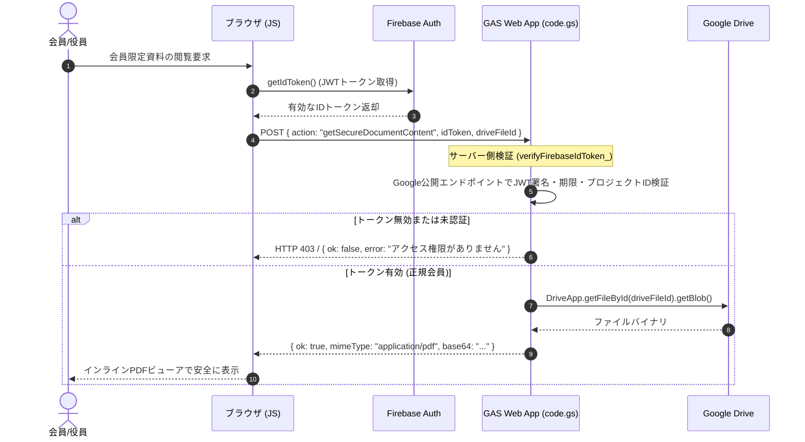

# Firebase Authentication 認証一本化・移行手順書

## 1. 概要と目的

若松町内会ホームページでは、旧来の Google Apps Script (GAS) ＋ スプレッドシートによる「ユーザーID＋4桁PIN」認証を廃止し、**Firebase Authentication** に認証を一本化します。
これにより、以下のセキュリティと利便性を両立します。

- **一般町内会員**: 複雑な個別登録を不要とし、広報紙・回覧板で配布された「町内会共通の合言葉」でログイン（閲覧専用）。
- **役員・管理者**: 個別のメールアドレスと8文字以上の強固なパスワードでログイン（行事登録、写真承認、備品貸出管理）。
- **完全無料運用**: Firebase Sparkプラン（月額0円・クレジットカード登録不要）の無料枠内で安全に運用。

---

## 2. 既存アカウント移行対応表 (要件3)

旧GAS認証台帳（スプレッドシート「役員_会員台帳」）に存在していたアカウントは、以下の通り Firebase Authentication へ移行します。
**旧PIN（4桁数字）はセキュリティ上非常に脆弱なため、一切移行・再利用しません。**

| 旧GAS ユーザーID | 旧役職 | 旧PIN扱い | Firebase移行後アカウント | 認証方式 | 付与ロール | 権限範囲 |
| :--- | :--- | :---: | :--- | :--- | :---: | :--- |
| **`test01`** 等の一般会員 | 一般 | **破棄** | `member@wakamatsu-cho.internal` (共通会員アカウント) | **共通の合言葉** (パスワード) | `member` | **閲覧専用** 会員限定の行事予定・回覧板PDF・写真アルバムの閲覧 |
| **`test02`** (役員テスト) | 役員 | **破棄** | `officer-test02@wakamatsu-cho.internal` (または役員個別メール) | **個別パスワード** (8文字以上英数記号) | `officer` | **管理操作** 公式行事登録・編集・承認、写真承認、備品予約管理 |
| **`niina`** (新名様) | 役員/管理者 | **破棄** | `niina@wakamatsu-cho.internal` (または新名様個別メール) | **強固な個別パスワード** (8文字以上) | `admin` | **特権管理者** 全管理操作、役員ロールの監査・付与、セキュリティ設定 |

---

## 3. Firebase Console での初期設定手順（画面単位の初心者向けガイド）(要件19)

本番公開前に、Firebase Console（Webブラウザ管理画面）で以下の3つの設定を実施します。

### ステップ1: Authentication（メール/パスワード認証）の有効化
1. [Firebase Console](https://console.firebase.google.com/) にアクセスし、プロジェクト **`wakamatu-HP`** を選択します。
2. 左メニューの「**構築**」>「**Authentication**」をクリックします。
3. 初回の場合は「始める」をクリックし、「**Sign-in method**」タブを開きます。
4. 「**メール/パスワード**」を選択し、スイッチを「**有効**」にして「**保存**」をクリックします（※「メールリンク」は無効のままで構いません）。

### ステップ2: ユーザーアカウントの作成
「**Users**」タブを開き、右上の「**ユーザーを追加**」ボタンから以下のアカウントを追加します。

1. **共通会員アカウント（合言葉の設定）**:
   - メールアドレス: `member@wakamatsu-cho.internal`
   - パスワード: **町内会員に周知する「共通の合言葉」**（例: 8文字以上の合言葉）
   - 「ユーザーを追加」をクリック。
2. **役員・システム管理者アカウント**:
   - メールアドレス: 役員・管理者の個別メールアドレス（例: `niina@wakamatsu-cho.internal`）
   - パスワード: 個別の強固なパスワード（8文字以上）
   - 「ユーザーを追加」をクリック。
   - ※作成後、一覧に表示される **`ユーザー UID`**（英数字の文字列）をコピーしておきます。

### ステップ3: Firestore `users` コレクションへの役員ロール登録
1. 左メニューの「**構築**」>「**Firestore Database**」をクリックします。
2. 「**データ**」タブを開き、「**コレクションを開始**」をクリックします。
   - コレクションID: `users`
3. ドキュメントを追加します：
   - ドキュメントID: **ステップ2でコピーした役員・管理者の `ユーザー UID`**
   - フィールド1: `role` (string) = `admin` または `officer`
   - フィールド2: `name` (string) = 氏名（例: `新名 智`）
   - フィールド3: `updatedAt` (timestamp) = 現在日時
   - 「保存」をクリック。
   > [!NOTE]
   > 共通会員アカウント（`member@...`）は `users` ドキュメントの登録は不要です（自動的に閲覧専用 `member` ロールとして扱われます）。

---

## 4. Firestore Security Rules の適用手順とロールバック手順 (要件20)

### 適用手順
1. Firebase Console > **Firestore Database** > 「**ルール**」タブを開きます。
2. 既存の `allow read, write: if true;` をすべて削除します。
3. リポジトリ内の [`firestore.rules`](file:///d:/町内会活動/町内会資料%20(まとめ）/町内会HP（Google）/firestore.rules) の全内容をエディタにコピー＆ペーストします。
4. 右上の「**公開**」ボタンをクリックします。
5. 「ルールが正常に公開されました」と表示されたら適用完了です。

### ロールバック手順（緊急時）
万が一、ルールの記述ミスや権限設定不備により正当なアクセスが遮断された場合：
1. 「ルール」タブ内の「**ルールの履歴**」をクリックします。
2. 直前に公開されていたバージョンを選択し、「**復元**」をクリックします。
3. 直ちに直前の状態へ戻すことができます。

---

## 5. 段階的移行手順 (要件4, 18)

1. **フェーズ1（準備・設定）**:
   - Firebase Console で Authentication と `firestore.rules` を適用し、アカウントを作成。
2. **フェーズ2（ステージング検証）**:
   - 作業ブランチ `feature/calendar-performance-optimization` にて、
     1. 未ログインでのアクセス（公開行事のみ表示、会員データ遮断）
     2. 共通合言葉でのログイン（会員限定行事・資料室の閲覧確認）
     3. 役員個別ログイン（行事追加・管理操作の確認）
     を実ブラウザで動作確認。
3. **フェーズ3（PRマージ・本番公開）**:
   - 承認後に PR #2 を `main` へマージし、GitHub Pages へ本番デプロイ。
4. **フェーズ4（旧GAS認証の完全無効化）**:
   - 会員への合言葉周知完了後、`code.gs` 内の `case "login":` を廃止し、スプレッドシートの「役員_会員台帳」シートのPIN列を完全削除。

---

## 6. Google Drive 写真・PDFのセキュア配信アーキテクチャ (要件15)

Google Drive に保管された非公開ファイル（役員会議事録、名簿、未承認写真等）は、単なるフロントエンドの表示制御ではなく、**サーバー側での完全なトークン検証** を経て配信されます。

このアーキテクチャにより、Google Drive の直URLを公開することなく、非公開資料の第三者漏洩を100%遮断します。
